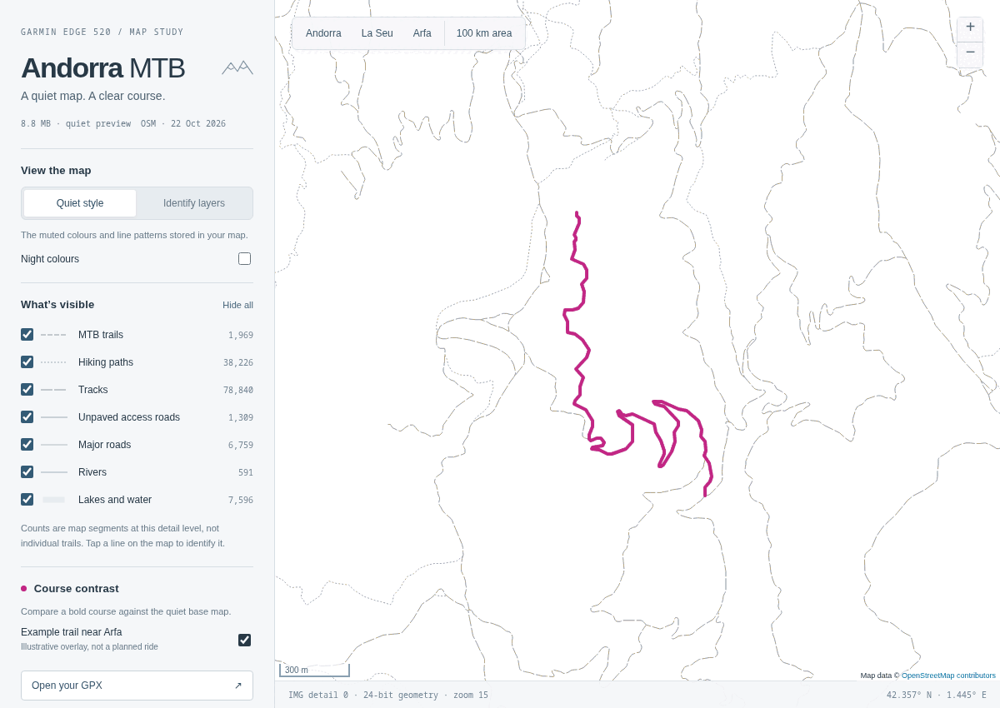

# Garmin 520 OSM maps

Reproducible MTB background maps for the **original Garmin Edge 520**, tested
with firmware **13.20**. The goal is to follow a GPX and distinguish the right
singletrack, with useful terrain context and familiar OpenMTBMap Easy colours.

Coverage: **Andorra, La Seu d’Urgell, Arfa and the Spanish side within roughly
100 km of Andorra la Vella**. No French map extract is used. The fixed extraction
polygon is [region.geojson](region.geojson).

## Results from the reconstruction

| Version | Size, decimal MB | Result |
| --- | ---: | --- |
| Original Andorra-only map | 3.55 | Detailed and colourful, but excludes La Seu/Arfa |
| Quiet custom OSM map | 8.84 | Works, but removes much more detail than the original |
| Whole OpenMTBMap tiles | 111.30 | Includes excess geography; too large |
| Precisely clipped full Easy-style replica | 75.16 | Rich base map and 20 m contours, no routing |
| Optimized Easy Trail, historical device build | **49.99** | Full navigation lines retained; reduced background clutter |
| Portable fresh rebuild, published scripts | **49.88** | Corrected polygon clipping, 24 m background tolerance |

The optimized output measured **49,987,584 bytes**, SHA-256
`7a61ce7f116bb037e1622af71226c34a48d7ac7adaf5655cf47ff3c625638fcc`.
It was written to the device and immediately checksum-verified. **Final
unmount/remount verification and a ride test of that version were still pending
when this repository was published.** The quiet version had previously been
confirmed working by the rider.

Reports from the build are in [results/](results/). They are a reference run,
not a promise that future upstream data will produce the same size or checksum.
The published pipeline was also tested from newly extracted upstream archives
through fresh clipping and compilation: **49,881,088 bytes**, with the original
TYP unchanged and navigation-line retention checks passing. This portable
rebuild was not copied to the device; its 24 m background setting is documented
below and in the session history.

## What the optimized map keeps

- Every non-contour line feature from the full replica, at every source detail
  level: roads, singletracks, paths, tracks, crossings, MTB/hiking route overlays,
  trail names and classifications. Per-tile hashes prove the filtered MP inputs
  retain these navigation lines unchanged.
- The original Easy **TYP payload**, byte-for-byte: familiar colours, road/path
  patterns, symbols and label styling. Species hatch overlays are omitted from
  the geometry, but the basic green forest fill remains.
- Forests, meadows, scrub, rock/scree, heath, wetlands, water and useful terrain
  context; place names, peaks/passes, water, gates, information points,
  huts/shelters, campsites, viewpoints and parking points.
- **40 m minor contours**, with **100 m and 500 m index contours**.

It removes buildings, urban land-use/sports polygons, crop-field/orchard/vineyard
shading, town-park fills, duplicate forest-species overlays, and non-navigation
POIs such as shops, restaurants, addresses, bus stops and ski-lift infrastructure.
Background polygons use a **24 m simplification tolerance at the finest level**
in the portable build (the historical device build used 21 m), increasing at
coarser levels. Trail/road geometry receives no additional
simplification beyond the full replica's compiler settings.

NET/NOD routing data, MDR/MDX address indexes and DEM grids are absent. Display
labels remain; absence of an index is not a guarantee that every Garmin firmware
will disable all POI lookup behaviour. This is a GPX background, not an
on-device routing engine.

## Quick start: optimized Easy-style map

Use Linux x86-64 with Bash, Java **17+** (tested with Temurin **21.0.13**), Python
**3.11+**, [uv](https://docs.astral.sh/uv/), curl, unzip, sha256sum and 7-Zip
(`7zz` or `7z`). Allow **4 GB Java heap** and about **4 GB working disk space**.
On Debian/Ubuntu, the OS packages are approximately:

```sh
sudo apt install default-jre python3 curl unzip p7zip-full
git clone https://github.com/kostyay/garmin520-osm-maps.git
cd garmin520-osm-maps
```

To recover the **exact historical Easy style**, supply your privately retained
old device IMG:

```sh
./scripts/prepare-sources.sh /absolute/path/to/backed-up/gmapbmap.img
./build.sh
```

Without the old backup, build from the current Andorra package instead:

```sh
./scripts/prepare-sources.sh
./build.sh
```

The latter uses the current Easy TYP and Andorra content; it cannot reproduce
the historical styling bytes. Source packages and extracted assets are cached
under ignored `sources/`; tools under ignored `.tools/`. No system Java is
installed by the scripts. `JAVA` may select a Java executable; set `JAVA_HOME`
for JPype when the runtime is outside the standard JVM search path.

Output: **`replica/optimized/build/gmapsupp.img`**. The build rejects a result at
or above **50,000,000 bytes** rather than silently removing more data.

### Pipeline

1. Download pinned mkgmap **r4924** and verify its SHA-256. The historical build
   used r4923, whose archived download was unavailable during reconstruction.
2. Download/extract current OpenMTBMap Spain. Recover Andorra's base, contours
   and Easy TYP from the old IMG, or download current Andorra as a fallback.
3. Download public OpenTopoMap Spain contours and select intersecting tiles.
4. Decode compiled IMG geometry with mkgmap's `MapReader`; clip to the actual
   extraction polygon; preserve Garmin type codes, labels and individual detail
   levels in Polish MP files. Reserve the Andorra tile rectangle for its own
   data so it is not duplicated by Spain tiles.
5. Convert public Spanish contour geometry from 10 m to 20 m intervals, retaining
   the old contour appearance. Optimize that to 40 m minor contours for the
   final under-50 MB build. Contour labels in IMG/MP are feet; the conversion
   handles that explicitly.
6. Remove background clutter, verify every navigation-line input hash, compile
   with `--no-net`, and verify the IMG's subfiles, coverage and exact TYP payload.

For the unoptimized 75 MB-style build:

```sh
./replica/build.sh
# output: replica/build/gmapsupp.img
```

For a faster recompile after MP clipping has already completed:

```sh
./replica/build-optimized.sh
```

Map size changes with upstream data, polygons and symbols. If a future build
exceeds the limit, inspect [replica/optimize.py](replica/optimize.py) and
[replica/build-optimized.sh](replica/build-optimized.sh); preserve the
navigation-line hash invariant while adjusting background detail or coverage.

## Downloads and provenance

| Input/tool | Download/source | Notes |
| --- | --- | --- |
| mkgmap | [r4924 ZIP](https://www.mkgmap.org.uk/download/mkgmap-r4924.zip), [project](https://www.mkgmap.org.uk/) | SHA-256 pinned in bootstrap |
| OpenMTBMap Spain | [download page](https://openmtbmap.org/download/odbl/), [desktop installer](https://ftp5.gwdg.de/pub/misc/openstreetmap/openmtbmap/odbl/mtbspain.exe) | Includes detailed Catalonia; separate contours |
| OpenMTBMap Andorra | [desktop installer](https://ftp5.gwdg.de/pub/misc/openstreetmap/openmtbmap/odbl/mtbandorra.exe) | Fallback when no legacy IMG is available |
| Spain contours | [OpenTopoMap page](https://garmin.opentopomap.org/), [ZIP](https://garmin.opentopomap.org/europe/spain/otm-spain-contours.zip) | Historical terrain data; reference IMG dated 2020 |
| GMapTool | [Linux version](https://www.gmaptool.eu/en/content/linux-version), [ZIP](https://www.gmaptool.eu/sites/default/files/lgmt08220.zip) | Used to split IMG containers; archive hash pinned |
| 7-Zip | [official downloads](https://www.7-zip.org/download.html) | Extracts the NSIS `.exe` packages without running them |
| Java | [Eclipse Temurin](https://adoptium.net/temurin/releases/) | Java 21 tested; use a local/system JRE |
| GPX/IMG inspection | [typconv](https://github.com/dyuri/typconv), [mkgmap docs](https://www.mkgmap.org.uk/doc/index.html) | TYP conversion was exploratory; builds preserve the binary TYP |

The reference Spain map package was downloaded **2026-10-23**. The old Andorra
base was dated **2025-10-26**, assembled **2025-11-01**; its 20 m contour tile
was named `OutDoormaps-cntrs20m-AD-02-Jun-2025`. Public Spanish contours come from
a different elevation source; matching colours does not make the terrain data
identical. The original Andorra TYP SHA-256 is
`80d22713442c88a2417487238b1dd5d35d22c174b274e997a17549d3bd6b5e40`.

The scripts record selected tile and downloaded archive hashes in
`sources/selection.json`. Preserve your original archives/backup privately for
historical reproduction. Current download URLs may change; a fresh download
will not necessarily recreate the reference data. To refresh intentionally,
move the old `sources/` cache aside and rerun preparation. IMG timestamps also
prevent a general promise of byte-identical rebuilds.

## Installing on the original Edge 520

Its basemap slot is **`Garmin/gmapbmap.img`**. The local deliverable is named
`gmapsupp.img`; do not assume copying only to `Garmin/gmapsupp.img` changes the
original 520's displayed basemap. This differs from newer Edge models.

Mount the device read/write, then use the helper. It backs up current maps,
verifies them, checks space, removes only an identical supplemental duplicate,
and overwrites the existing basemap **in place**:

```sh
garmin_mount="/run/media/$USER/GARMIN" # adapt for your machine
image=replica/optimized/build/gmapsupp.img
python3 scripts/install.py "$image" "$garmin_mount"
garmin_device=$(findmnt -n -o SOURCE --target "$garmin_mount")
udisksctl unmount -b "$garmin_device"
udisksctl mount -b "$garmin_device" -o rw
python3 scripts/install.py "$image" "$garmin_mount" --verify-only
udisksctl unmount -b "$garmin_device"
```

Linux may require your own authentication to remount. Confirm the block device
with `lsblk` rather than assuming `/dev/sda`. Flash writes can take several
minutes even after the file has its final size; wait for `fsync`/sync and the
verification to finish. Unmounting is enough to unplug safely if USB power-off
requires additional authorization. Disconnect, fully power off/on, then inspect
Andorra/La Seu/Arfa at **80, 200, 500 and 800 m** and follow a known GPX course.

The first staged-write/rename installation appeared to verify from Linux's
cache but did not survive a restart. Both old 3.55 MB maps reappeared, leaving
Arfa blank. The cause was not established. Direct overwrite followed by a full
unmount/remount checksum check worked for the quiet map; do not skip the
persistence check. See [the session history](docs/session-history.md).

## GPX course names

Changing filenames alone is insufficient: update metadata and track/route names.
Read the original embedded titles before assigning days; the two files in this
session were supplied in the opposite order to their Day 1/Day 2 titles.

```sh
python3 scripts/rename-gpx.py original-day1.gpx Arfa_Day_1.gpx 'Arfa Day 1'
python3 scripts/rename-gpx.py original-day2.gpx Arfa_Day_2.gpx 'Arfa Day 2'
cp Arfa_Day_1.gpx Arfa_Day_2.gpx "$garmin_mount/Garmin/NewFiles/"
sync
```

The script verifies point content is unchanged. After a safe eject/restart,
the Garmin imports GPX files into courses (FIT); imported files may disappear
from `NewFiles`. Personal GPX/FIT files and backups are ignored by Git.

## Quiet-map experiment and browser viewer



Captured locally from the **earlier quiet-map experiment**, not the recommended
optimized Easy map or an Edge 520 emulator. The animation cycles through course
contrast, highlighted layer colours, and the base map alone. The magenta overlay
is a public OSM trail example, not a planned ride or personal GPX.
[Full-size still screenshot](docs/assets/quiet-map-preview.png).

The original lean reconstruction is retained for comparison:

```sh
cd quiet
./build.sh             # additionally requires osmium-tool
cd ..
uv run preview/export.py
python3 -m http.server 8767 --bind 127.0.0.1 --directory preview/dist
```

Its raw OSM inputs are pinned in [quiet/sources.txt](quiet/sources.txt) with
hashes. Andorra, Catalonia and Aragón are merged with `osmium merge`, then cut
to the polygon with `osmium extract` before mkgmap. It has no contours/POIs,
one-pixel muted lines, six line types and a 270-byte custom TYP. The rider found
it too sparse; it is **not the recommended optimized Easy map**.

For newer raw OSM data, resolve current dated downloads from
[Geofabrik Andorra](https://download.geofabrik.de/europe/andorra.html),
[Catalonia](https://download.geofabrik.de/europe/spain/cataluna.html) and
[Aragón](https://download.geofabrik.de/europe/spain/aragon.html), update both
`quiet/sources.txt` and `quiet/sources.sha256`, and remove cached `quiet/data/`
inputs. The old dated snapshots may eventually be removed by the provider.

The browser viewer decodes the quiet IMG itself: seven layer toggles, location
shortcuts, day/night/inspection modes, a GPX overlay and a screen-outline helper.
GPX files stay in the browser. Browser rendering and zoom thresholds approximate
Garmin firmware. It does not render the newer Easy map. See
[preview documentation](docs/preview.md) for local/tailnet hosting.

## Checks, identifiers and project files

To inspect another map, split its tiles first (a container can hold multiple
TRE maps; inspecting just the first one misses layers such as contours):

```sh
mkdir -p sources/inspection
"${GMT:-.tools/gmt}" -i /absolute/path/to/map.img
"${GMT:-.tools/gmt}" -s -o "$PWD/sources/inspection" /absolute/path/to/map.img
uv run scripts/inspect-map.py sources/inspection > sources/inventory.json
```

```sh
python3 scripts/self-test.py
python3 replica/verify.py replica/optimized/build
```

Optimized builds check `<50,000,000` bytes, exact selected TYP bytes, expected
tile IDs, Andorra/La Seu/Arfa bounds, contour types and absent routing/index/DEM
subfiles. The optimizer requires identical per-tile non-contour line-input
hashes. These checks do not prove OSM is complete or a physical trail is rideable.

Easy builds keep family **6373**, product **1**, to match the recovered TYP.
Quiet builds use private family **52371**, product **1**, tile **52371001**.
These are local conventions, not globally reserved IDs.

The fixed region can be regenerated with
`uv run scripts/make-region.py > new-region.geojson`; inspect it before replacing
the stored polygon. It combines country outlines with the full Geofabrik Andorra
outline to preserve border trails.

This public repository contains original code, documentation and sanitized
reference reports—not personal tracks, device IDs, private network addresses,
downloaded map packages or third-party TYP binaries. Acquire those inputs from
their providers or your own backup. Original code is [MIT licensed](LICENSE);
map data, tools, symbology and vendored Leaflet retain their own licenses and
attribution. See [third-party notes](docs/third-party.md).
